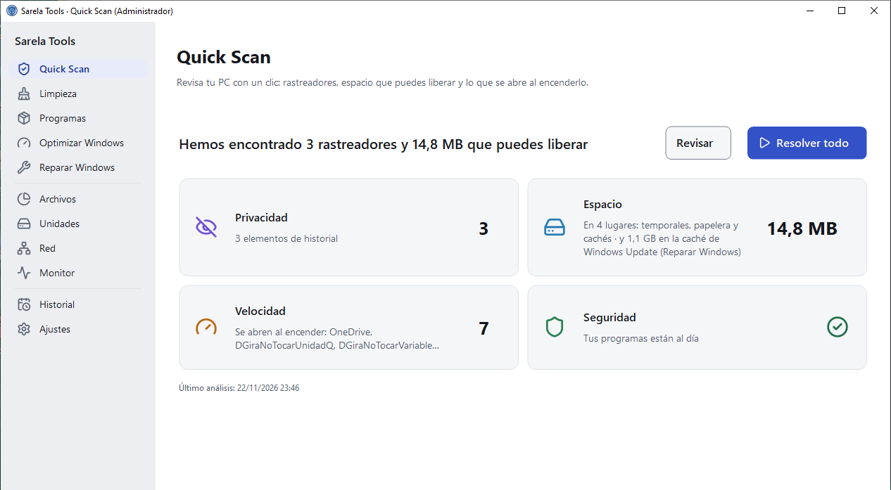
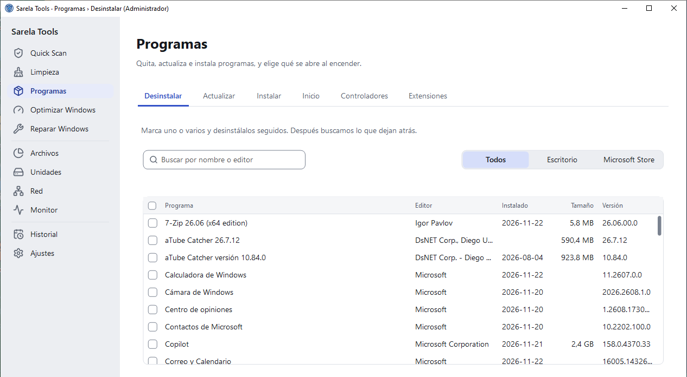
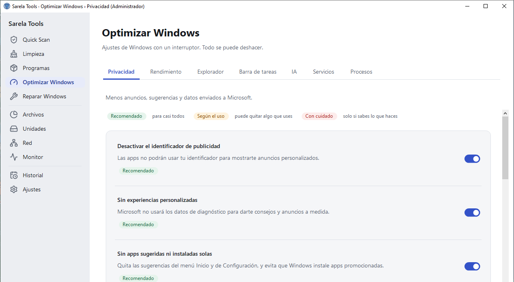
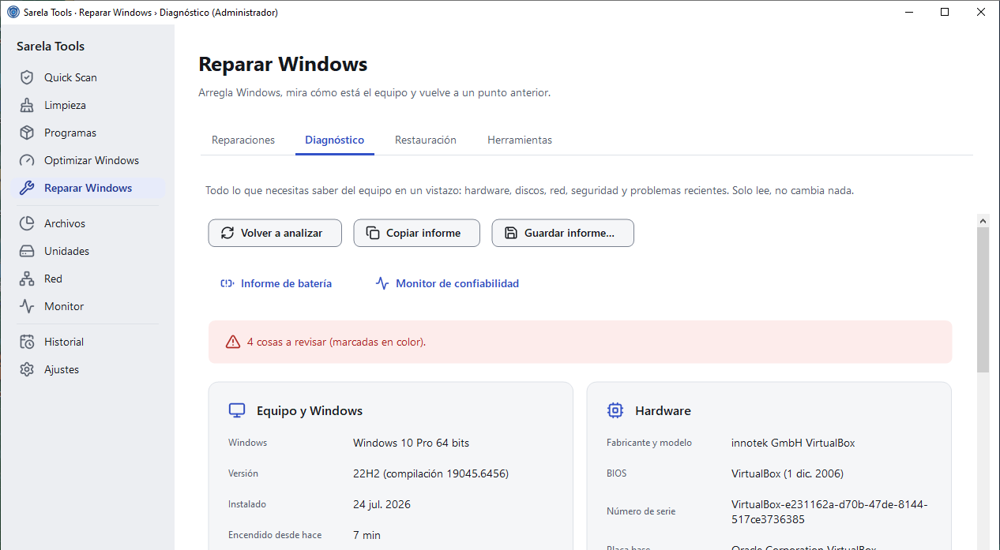
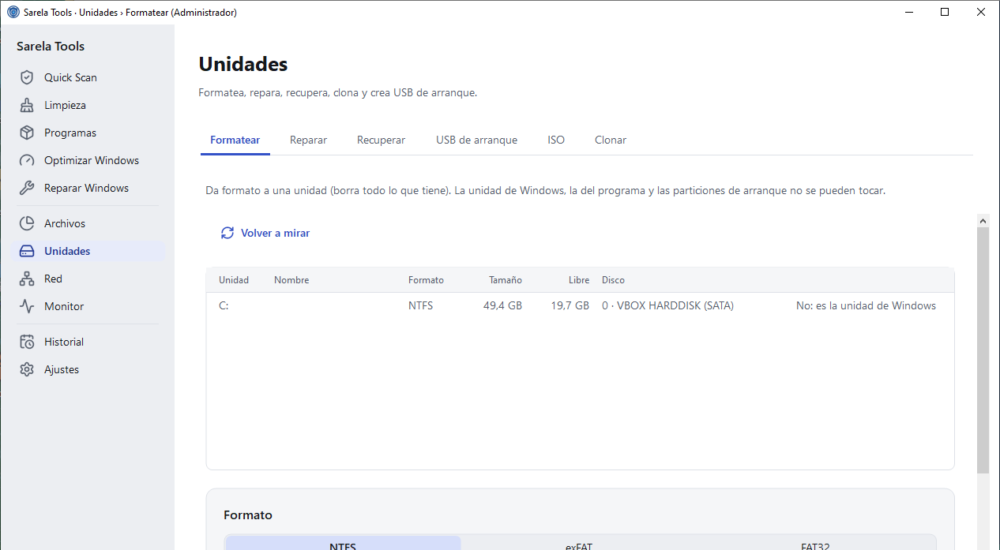
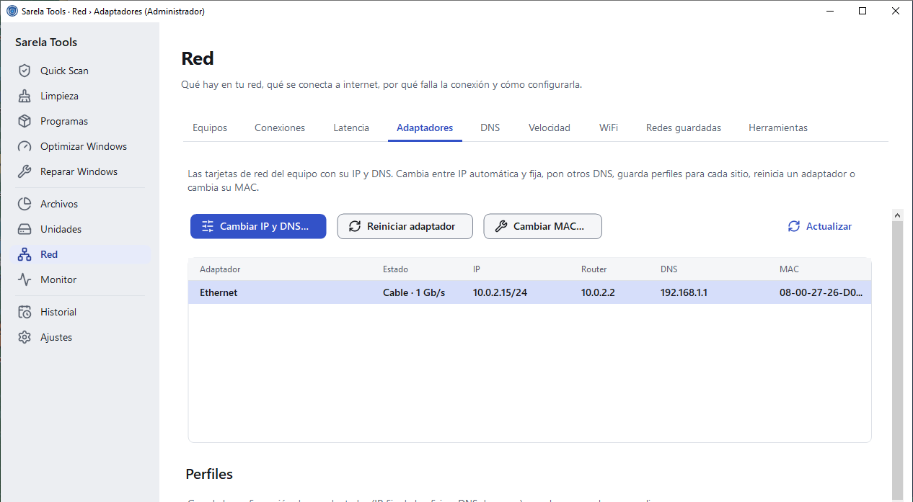
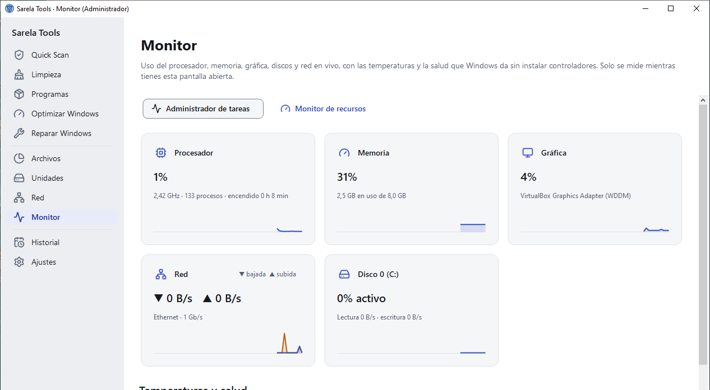

  

<h1 align="center">Sarela Tools</h1>

  Limpia, optimiza y repara Windows, y gestiona unidades y red, desde una sola aplicación. 
  Gratuita, sin anuncios, en español y en inglés.

  <a href="../../releases/latest"><b>⬇ Descargar Sarela Tools 1.0</b></a>
  &nbsp;·&nbsp; Windows 10 y 11 &nbsp;·&nbsp; Portable o instalada

  

---

## Descarga y uso

1. Entra en [**Releases**](../../releases/latest) y descarga **`Sarela Tools 1.0.zip`**.
2. Descomprime el zip en una carpeta (o en un USB).
3. Abre **`Sarela Tools.exe`**. La primera vez te pregunta si quieres usarla como **portable** (sin instalar nada, los datos se guardan junto al programa) o **instalarla** en el equipo (menú Inicio y «Aplicaciones instaladas»).

> **Aviso de Windows SmartScreen:** el ejecutable todavía no está firmado digitalmente, así que Windows puede mostrar «Windows protegió su PC». Pulsa **Más información › Ejecutar de todas formas**.

**Requisitos:** Windows 10 (versión 1903 o posterior) u 11, con .NET Framework 4.8 (ya viene con Windows). Muchas funciones piden permisos de administrador.

**Contenido del zip:** `Sarela Tools.exe`, `Sarela Tools.cfg` (configuración del modo portable), `LICENCIA.txt` y `LICENSE.txt`.

## Qué hace

| Sección | Funciones |
| --- | --- |
| **Quick Scan** | Revisa el PC con un clic: rastreadores, espacio que se puede liberar, programas que arrancan con Windows y programas por actualizar. No borra nada sin que lo veas antes. |
| **Limpieza** | Limpieza a medida de Windows y de los navegadores (respetando las cookies que quieras conservar), limpieza del sistema, registro de Windows con copia de seguridad y cachés de la nube. Limpieza automática programada. |
| **Programas** | Desinstalar uno o varios y buscar los restos que dejan, forzar la eliminación de programas rotos, actualizar e instalar programas con winget, elegir qué arranca con Windows, copia de los controladores y extensiones de los navegadores. |
| **Optimizar Windows** | Ajustes de privacidad, rendimiento, Explorador, barra de tareas y funciones de IA con un interruptor, todo reversible. Servicios y procesos. Exportar e importar la configuración. |
| **Reparar Windows** | Reparaciones guiadas (red, DNS, Windows Update, impresoras, SFC, DISM…) con registro de lo hecho, mantenimiento completo, diagnóstico del equipo con informe, puntos de restauración y accesos directos a las herramientas de Windows. |
| **Archivos** | Qué ocupa espacio, duplicados, carpetas vacías, accesos directos rotos, copia de seguridad de tus carpetas, desbloquear archivos en uso y borrado seguro del espacio libre. |
| **Unidades** | Formatear (también FAT32 de más de 32 GB), comprobar y reparar discos, recuperar archivos borrados (NTFS y FAT32), crear USB de arranque, montar ISO y discos virtuales, y clonar discos. |
| **Red** | Equipos de tu red y sus puertos, conexiones abiertas, bloquear programas en el cortafuegos, latencia salto a salto, adaptadores (IP, DNS, MAC), comparar servidores DNS, velocidad de la red entre dos PCs, WiFi y canales, redes guardadas (con código QR) y herramientas: ping, ruta, puertos, certificados, Whois, calculadora de subredes y Wake-on-LAN. |
| **Monitor** | Procesador, memoria, gráfica, discos y red en vivo, con la salud de los discos y la batería. |
| **Historial y Ajustes** | Lo que se ha limpiado y reparado; tema claro u oscuro, idioma, exclusiones, carpetas propias y limpieza automática. |

## Capturas

| | |
| --- | --- |
|  |  |
| **Limpieza a medida** | **Programas** |
|  |  |
| **Optimizar Windows** | **Reparar Windows** |
|  |  |
| **Diagnóstico del equipo** | **Unidades** |
|  |  |
| **Red** | **Monitor** |

## Privacidad

Sarela Tools no recoge ni envía datos a nadie. Tu historial, tus ajustes y tus registros se guardan solo en tu equipo. Solo se conecta a Internet cuando tú lo pides (por ejemplo, para reparar Windows con DISM, instalar programas con winget o consultar tu IP pública).

## Importante

Sarela Tools hace cambios profundos en el sistema: borra archivos, modifica el registro, detiene servicios, formatea y clona discos. Algunas acciones no se pueden deshacer. **Haz copia de seguridad de tus datos antes de usarla** y crea un punto de restauración cuando el programa te lo ofrezca. Se ofrece «tal cual», sin garantía.

## Licencia

Sarela Tools es **gratuito** pero **no es de código abierto**: el código fuente no se publica. Puedes usarlo en tus equipos y, como técnico, en equipos de otros con su permiso, y pasar copias completas y sin modificar de forma gratuita. No se puede vender ni distribuir modificado sin permiso del autor. Texto completo: [LICENCIA.txt](LICENCIA.txt) (versión en inglés: [LICENSE.txt](LICENSE.txt)).

Los iconos son de [Lucide](https://lucide.dev) (licencia ISC) y Feather (licencia MIT). Los nombres de programas y marcas de terceros pertenecen a sus titulares.

## Apoya el proyecto

Si Sarela Tools te ha ahorrado tiempo, puedes invitar a su autor a un café en **[Ko-fi](https://ko-fi.com/dgiratools)**. Es totalmente voluntario y no desbloquea nada: todas las funciones son gratis.

## Contacto

Dudas, fallos o sugerencias: **dgira.tools@gmail.com** o en la pestaña [Issues](../../issues).

© 2026 DGira Tools.

---

<b>English</b>

**Sarela Tools** is a free Windows 10/11 toolkit to clean, optimize and repair Windows and manage drives and networks: Quick Scan, custom and system cleanup, registry cleaner with backup, uninstaller with leftovers search, winget updates and installs, startup manager, privacy and performance tweaks, guided repairs, system diagnostics, restore points, disk space analyzer, duplicates, secure free-space wipe, formatting (including FAT32 over 32 GB), disk check, file recovery (NTFS/FAT32), bootable USB, disk cloning, network scanner, latency, adapters, DNS benchmark, LAN speed test, WiFi tools and a live hardware monitor. The interface is available in English and Spanish (it follows the Windows language).

**Download:** get `Sarela Tools 1.0.zip` from [Releases](../../releases/latest), unzip it and run `Sarela Tools.exe` (portable, or install it from the first-run dialog). The executable is not code-signed yet, so SmartScreen may warn you: click *More info › Run anyway*. Requires .NET Framework 4.8 (included in Windows 10 1903+ and Windows 11).

Free to use, not open source. See [LICENSE.txt](LICENSE.txt) (the Spanish [LICENCIA.txt](LICENCIA.txt) is the binding version). Support: [Ko-fi](https://ko-fi.com/dgiratools) · Contact: dgira.tools@gmail.com

